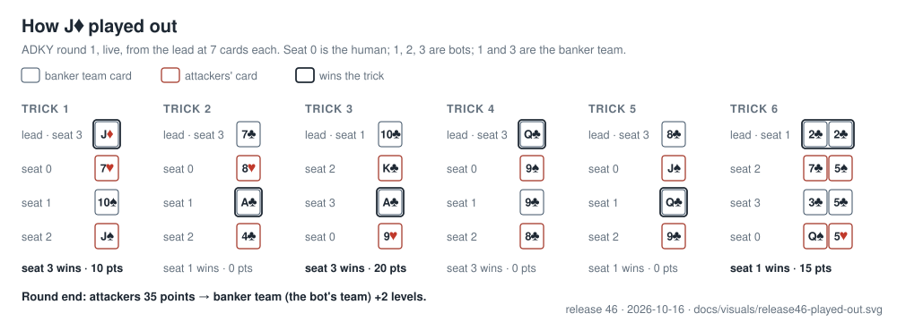
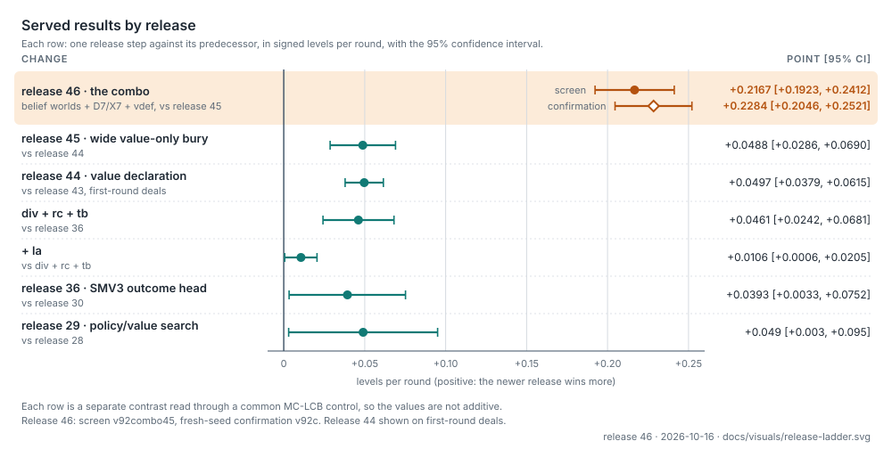

# Sheng Ji (升级 / Tractor)

**Play it now: https://shengji.fly.dev** — solo vs bots or share a room code
with friends (phones: landscape).

The classic Chinese partnership trick-taking game: Python rules engine, Monte
Carlo AI guided by a learned model, FastAPI multiplayer server, and React web UI
with Mandarin voice announcements.

## The production bot

**Live: release 46** (since 2026-10-16 14:49 ET), the combo: belief-model worlds + exact endgame at
7 cards + every-chance first-round value declaration, on release 45. Release 45 is the SMV3
outcome-head package `smv3out-491ee4bf.npz` in the one-ply policy/value search (64 worlds,
8 candidates) with five search rules (div, rc, tb, la, dtr), the value-guided trump declaration
(release 44) and the wide value-only bury (release 45). The model owns declaration, bury and card
play; the heuristic is the anchor and the fallback. Colour marks what release 46 added: violet belief,
berry exact endgame, blue declaration.





Rule tokens used in the figures and tables:

- **div**: diversify candidates (at most 2 of the same shape)
- **rc**: keep only worlds where this round's refused throws stay refusable
- **la**: lead anchor: on a weak-single lead, admit the strongest pair/tractor as candidate zero
- **tb**: tie-break near-equal moves by points won this trick
- **dtr**: drop a lead throw the engine would refuse in every world
- **vd**: value-guided trump declaration
- **vdef**: in round 1, consult the value head at every declare chance
- **whl / whd**: sampled worlds must be consistent with every earlier follow (history-legal)
- **bw**: hidden hands proposed by the S17 belief model
- **ele / ed7 / xf7**: exact endgame search for leads and follows at ≤7 cards
- **bwv**: wide value-only bury (64 candidate kitties)



**Served results** (signed levels per round, 95% CI; indirect contrasts through a common MC-LCB control):

| change | against | result | reading |
|---|---|---|---|
| the combo (belief worlds + D7/X7 exact endgame + vdef) | release 45 | +0.2167 [+0.1923, +0.2412]; confirmation +0.2284 [+0.2046, +0.2521] | POSITIVE and CONFIRMED (v92combo45, v92c) |
| wide value-only bury K=64 (release 45) | release 44 | +0.0488 [+0.0286, +0.0690] | POSITIVE, one ten-window screen on first-round deals, not confirmed (v76bwv44) |
| value-guided declaration (release 44) | release 43 | +0.0497 [+0.0379, +0.0615] first-round; +0.0352 [+0.0233, +0.0471] later-round | POSITIVE in both populations, ten windows each (v70vd43, v71vd43lr) |
| doomed-throw swap / re-select (releases 42, 43) | release 38 / 42 | interval spans zero | correctness fixes, no strength claim |
| div + rc + tb | release 36 | +0.0461 [+0.0242, +0.0681] | CONFIRMED, ten fresh windows (#676) |
| + la | div + rc + tb | +0.0106 [+0.0006, +0.0205] | POSITIVE incremental (not a confirmation): small, ten windows, lower bound near zero (#676) |
| SMV3 outcome head (release 36) | release 30 | +0.0393 [+0.0033, +0.0752] | predeclared confirmation (#663) |
| policy/value search (release 29) | release 28 | +0.049 [+0.003, +0.095] | five windows; card play +0.086 [+0.042, +0.131] |

The exact contract, the caveats on these reads, what was tried and not taken, and every earlier release:
[AI_POLICIES.md](AI_POLICIES.md#production-contract) and its
[ladder](AI_POLICIES.md#the-ladder-every-production-change-and-what-it-measured).
Rollback and gates: [DEPLOY.md](DEPLOY.md). Every screen: [Atlas v2](docs/atlas_v2/registry.json).
Open work: the board issue (see AGENTS.md) and [RL_PLAN.md](RL_PLAN.md#planned-work).

## How a strength change ships (current workflow)


The screen never plays the candidate against the release directly: both play the same fixed MC-LCB
control on the same deals, and the result is the difference. That puts the two arms of one screen on one scale; rows
of the ladder come from different eras and instruments, so read each alone. Confirmation runs when Jerry or the
packet requires it.

## Quick start

```bash
# 1. Build the frontend (once, or after UI changes)
cd web && npm install && npm run build && cd ..

# 2. Run the server (serves the built UI at http://localhost:8000)
cd server && uv sync && uv run shengji-server
```

Open http://localhost:8000, create a room, add 3 bots (or share the room code
with friends on your network), and start. For frontend development, run
`npm run dev` in `web/` (Vite on :5173, talks to the server on :8000).

Tests: `cd server && uv run python scripts/test_checkout.py --engine pure -- -q`.
The entrypoint anchors imports to its own checkout, prints the source and engine,
and checks both before pytest starts. It also works with a shared environment's
Python from another working directory; pass the absolute script path. Use
`--engine compiled` after building that checkout's extension; missing native
code fails instead of silently counting pure coverage. Pure mode unsets
`SHENGJI_FAST` (setting it to `0` is not sufficient).

For a small, model-free producer-to-consumer diagnostic rehearsal:
`uv run python scripts/test_checkout.py --engine pure -- -q tests/test_m9_readout_persistence_roundtrip.py`.
This exercises synthetic collection, persisted panels and final summarization;
it is not a real-model qualification or scientific run. Frontend checks:
`cd web && npm ci && npm run lint && npm test && npm run build` (from repo root).
Headless bot-vs-bot evaluation: `uv run python -m shengji.ai.env`.

## Rules implemented (standard 4-player, 2 decks)

- Teams 0+2 vs 1+3 climb levels 2 to A; the banker team's level is the trump rank.
- Live dealing: anyone may declare mid-deal by revealing trump-rank card(s).
  A pair beats a single; a joker pair declares no-trump and beats both.
  A short grace window allows over-declarations. With no declaration, trump
  is flipped from the kitty. The first round's first declarer becomes banker.
- Banker takes the 8-card kitty and buries 8.
- Pairs, tractors (consecutive pairs, trump-aware adjacency incl. rank cards
  and jokers) and throws (甩牌); an invalid throw is forced down to its lowest
  component.
- Follow suit with matching count; pairs must cover pair leads; a tractor lead
  obliges an in-suit tractor of that length if you hold one; a void hand may
  trump with a shape-matching play.
- Points: 5s=5, 10s/Ks=10 (200 total). Attackers win at 80; taking the last
  trick multiplies kitty points by 2 × the size of the winning play.
- Scoring: attackers at 0 give the banker +3, under 40 +2, under 80 +1;
  attackers at 80+ take the deal and gain (points−80)/40 levels. A game is
  won by **defending** at level A. A room then plays on: the winning team
  scores a game and both teams restart at the room's starting level, which the
  host picks before the first deal.

House rules (v1): throws are checked against all three other hands with no
10-point penalty; pair obligations for multi-component throws use the
pair-count rule.

## Layout

```
server/shengji/engine/   cards, combos (tractor decomposition), legality, round, game
server/shengji/ai/       policies: heuristic.py, smart.py + memory.py (card-counting
                         heuristic), mcbot.py (the Monte Carlo search), cwv_numpy.py
                         (the Torch-free package runtime), refusal.py (refusal-aware
                         world sampling), registry.py (SHENGJI_BOT names are derived
                         from the fly.toml env, never hand-written)
server/shengji/train/    pv_search_policy.py + policy_value_search.py (the served play
                         search, value declare and wide bury), cwv_bury_policy.py (hybrid
                         bury), the shortlist-era bots, screens
server/shengji/rl/       encoders, action enumeration, the value/policy model, trainer
server/shengji/harvest/  self-play trajectory corpora (the training data)
server/shengji/eval/     diagnostic panels, readers and the tactical fixture runner
server/shengji/api/      FastAPI WebSocket server (rooms, bots, per-seat state)
server/scripts/          export_cwv_numpy.py, cwv_serving_gate.py, cwv_serving_smoke.py,
                         replay.py, xray.py
server/tests/            unit tests + randomized self-play soak tests
web/                     React + TypeScript UI (Vite)
PROTOCOL.md              WebSocket protocol contract
```

The engine is authoritative and UI-free; the server maps card instance ids to
codes per seat so hidden information never leaves the server.

## Other policies in the registry

- `mc-s0-report-lcb`: the bare MC-LCB search; the common control of every served screen and
  the deep rollback.
- The shortlist-era packages (releases 22–28): registered rollbacks (order in [DEPLOY.md](DEPLOY.md)).
- `smart` and `heuristic`: the hand-written baselines.

Closed lanes (PUCT with the heads, root allocation, the BELIEF and privileged-teacher
teachers, direct-Q, Suphx O0) are lessons in [AI_POLICIES.md](AI_POLICIES.md) and
[RL_PLAN.md](RL_PLAN.md), not policies. The G1 grid trunk, a served null in gen 4, is back as the
C14 training run (RL_PLAN "Planned work").

## Debugging & analysis tools

- `scripts/replay.py` — render any room log (`logs/<ROOM>.jsonl`) as a full
  transcript with all hands.
- `scripts/xray.py` / the in-game X-ray (press `x`; needs
  `SHENGJI_DEBUG_TOKEN`) — what the bot sees and would play from any position,
  on an isolated snapshot (the live bot's RNG is untouched). It decodes
  shortlist-era records (W32 nominations, MC selection estimates, the report-gap
  decision). For the pv-search bot it shows the pick and the bot's memory, not
  the admitted candidates' value means.
- `scripts/fetch_fly_logs.sh` — stage, validate, refresh and hash prod logs.
- `python -m shengji.rl.human_shards` — build a replay-audited human play/bury
  corpus (raw human choices are proposal data until counterfactually validated).

## Project docs

| file | what it holds |
|---|---|
| `AI_POLICIES.md` | production contract, measured policies, evidence and lane rules |
| `RL_PLAN.md` | research plan, key learnings, measurement rules |
| `DEPLOY.md` | release records, rollbacks, gates |
| GitHub issue #707 + topic issues | the live investigation board and work queue |
| `docs/atlas_v2/` | every screen since release 29 (`registry.json`) |
| `docs/scaling_log/` | every model with its offline metrics; engine and search speed (with issue #208) |
| `docs/EXTERNAL_SSD.md` | what lives on the external SSD (corpora, backups) and its rules |
| `incidents/` / `server/tests/` | postmortems; the validation suite |
| `AGENTS.md` | execution discipline and agent orchestration |
| `HANDOFF_REVIEW.md` | frozen authority markers (#674) |
| `PROTOCOL.md` / `web/README.md` | wire protocol; client architecture |
| `BACKLOG.md` | deprecated; see #707 |
| `docs_archive/` | compacted history: closed lanes, old designs, rotated ledgers |

Top-level documents hold only current project, operational or durable contract
surfaces. Completed one-off specs are summarized in their owner and moved to
`docs_archive/`.
